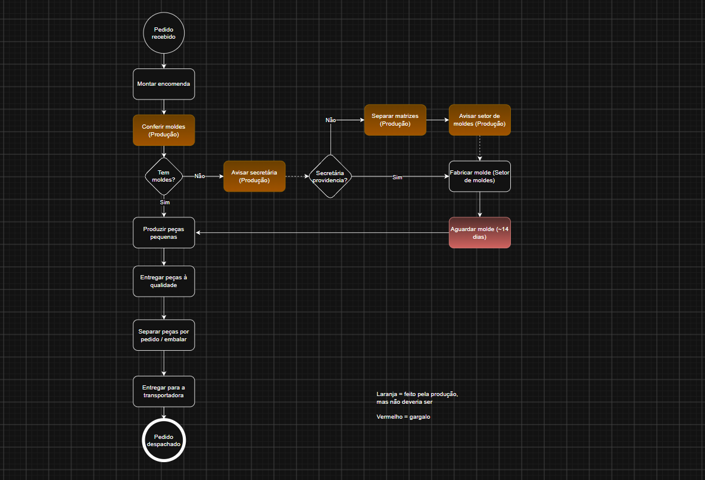
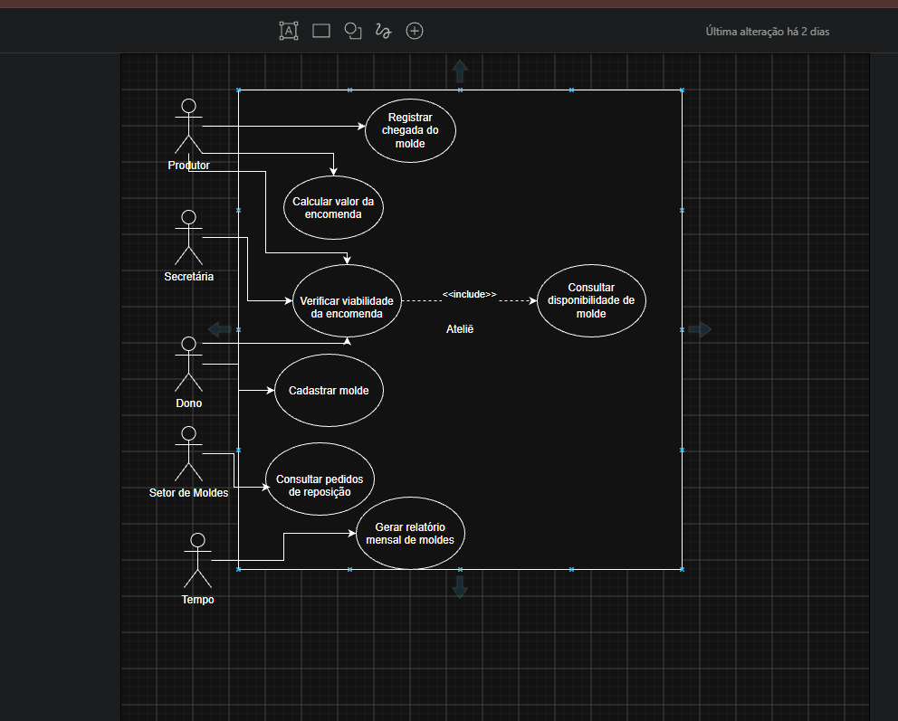

# Ficha de Produção

Sistema de controle de produção para ateliê de artesanato em resina. Substitui o controle em papel por um banco de dados consultável, e responde perguntas que antes ninguém conseguia responder.

Projeto em desenvolvimento, já em uso no dia a dia da empresa onde trabalho. O sistema responde a pergunta de ponta a ponta (banco, API e tela), hoje cobrindo parte do catálogo de moldes: o gargalo atual não é técnico, é o inventário físico que ainda está sendo cadastrado.

---

## O problema

A ficha de produção vivia no papel. Cada recibo, cada peça produzida, cada molde usado ficava registrado à mão. Isso gerava três problemas:

- A informação se perdia. Papel some, molha, é descartado.
- Não dava para responder perguntas simples: quanto essa peça faturou no trimestre, qual molde está parado, quanto tempo leva para produzir uma encomenda.
- A decisão de aceitar ou não uma encomenda com prazo apertado era feita no achismo.

## O que o sistema faz

- Registra recibos e os itens de cada recibo
- Cadastra e controla moldes, com capacidade de produção por molde
- Calcula se uma encomenda cabe em um prazo, cruzando a quantidade pedida com a capacidade real de produção
- Gera relatório mensal de uso de moldes

---

## Stack

| Camada | Tecnologia |
|---|---|
| API | Python, FastAPI |
| Banco | PostgreSQL (Neon), SQLite em desenvolvimento |
| Consultas | SQL (CTE, JOIN, agregações) |
| Servidor | Uvicorn |

---

## Modelagem

Antes de escrever código, mapeei o processo da encomenda em dois diagramas.

### Fluxo do processo (AS-IS)



O mapeamento revelou dois pontos que não eram visíveis no dia a dia:

- **Gargalo de ~14 dias**: quando o molde não existe, a encomenda fica parada esperando a fabricação
- **Atividades fora do setor**: parte do que a produção executa hoje deveria ser responsabilidade de outro setor

### Casos de uso



Atores: Produtor, Secretária, Dono, Setor de Moldes e Tempo. O Tempo aparece como ator porque o relatório mensal não é disparado por uma pessoa, e sim pela virada do mês.

### Estrutura de dados

As tabelas principais são `recibos`, `itens_recibo`, `molde` e `produtos`.

A relação entre recibo e item usa integridade referencial com remoção em cascata: um item não existe sem o recibo ao qual pertence, então se o recibo é removido, seus itens vão junto. Essa não é uma decisão de sintaxe, é uma decisão sobre como o dado deve se comportar.

---

## Destaque técnico: cálculo de capacidade

O endpoint `/api/capacidade` recebe uma encomenda e um prazo, e responde se a produção cabe no período.

A capacidade de cada molde é calculada como:

```
unidades_disponiveis × pecas_por_enchimento × enchimentos_por_dia = capacidade por dia
```

A partir disso, a query calcula quantos dias cada item precisa e retorna o pior caso.

Dois pontos de atenção resolvidos na consulta:

**Divisão por zero.** Quando um item não tem molde cadastrado, ou o molde está sem unidades disponíveis, a capacidade dá 0 e a divisão quebra a query inteira. O `NULLIF` troca o 0 por `NULL`, o cálculo retorna `NULL` em vez de erro, e o item aparece sinalizado no fim da lista em vez de derrubar a resposta.

**Legibilidade.** A consulta usa CTE (`WITH`) para separar a seleção dos itens da encomenda do cálculo de capacidade, em vez de aninhar tudo em uma subquery só.

Resposta do endpoint:

```json
{
  "encomenda": "...",
  "prazo_dias": 14,
  "total_pecas": 0,
  "pior_caso_dias": 0,
  "itens_total": 0,
  "itens_analisados": 0,
  "cabe_no_prazo": true,
  "itens": []
}
```

---

## Como rodar

```bash
git clone https://github.com/Janisvaldo1/ficha-producao.git
cd ficha-producao/backend

python -m venv venv
.\venv\Scripts\Activate.ps1      # Windows
# source venv/bin/activate       # Linux/macOS

pip install -r requirements.txt

cp .env.example .env             # preencha com sua string de conexão

uvicorn app.main:app --reload
```

Documentação interativa da API disponível em `http://127.0.0.1:8000/docs`.

---

## Projeto em evolução

Este sistema é meu laboratório de estudo. Cada disciplina que curso em Sistemas de Informação eu aplico aqui, sobre um problema real, em vez de resolver exercício isolado. Por isso ele cresce em camadas e não tem data de conclusão.

| Disciplina | O que virou prática no projeto |
|---|---|
| Modelagem de Negócios | Mapeamento do processo da encomenda, diagrama de fluxo e casos de uso, identificação de gargalo |
| Banco de Dados | Modelagem relacional, integridade referencial entre recibo e itens, consultas com agregação e CTE |
| Desenvolvimento Ágil | Backlog em `TAREFAS.md` organizado em ciclos, cada ciclo entregando uma fatia vertical (banco → API → tela), com limite de uma tarefa em andamento por vez e validação com o usuário final ao fim de cada ciclo |
| Gestão de TI | Separação de configuração e credenciais (`.env` / `.env.example`), escolha de banco gerenciado em vez de infraestrutura própria, documentação da migração em `MIGRATION_GUIDE.md` |
| Teste de Software | Script de validação da migração SQLite/Postgres em `test_database.py` |

## Próximos passos

- [ ] Automatizar o relatório mensal de moldes
- [ ] Tratar valores monetários com `NUMERIC` em vez de ponto flutuante
- [ ] Cobertura de testes nos endpoints principais
- [ ] Containerizar com Docker

---

## Contexto

Projeto construído enquanto curso Sistemas de Informação, aplicando no trabalho real o conteúdo de cada disciplina. A modelagem de processo deste repositório, por exemplo, nasceu da matéria de Modelagem de Negócios.

[LinkedIn](https://www.linkedin.com/in/janisvaldo-junqueira-524072345/)